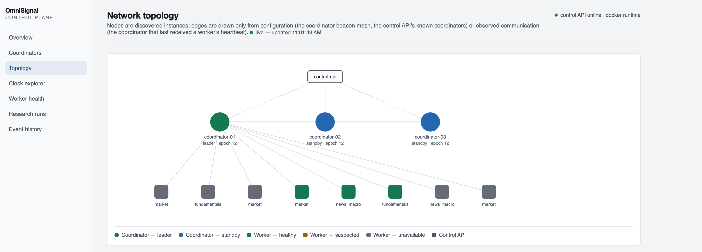
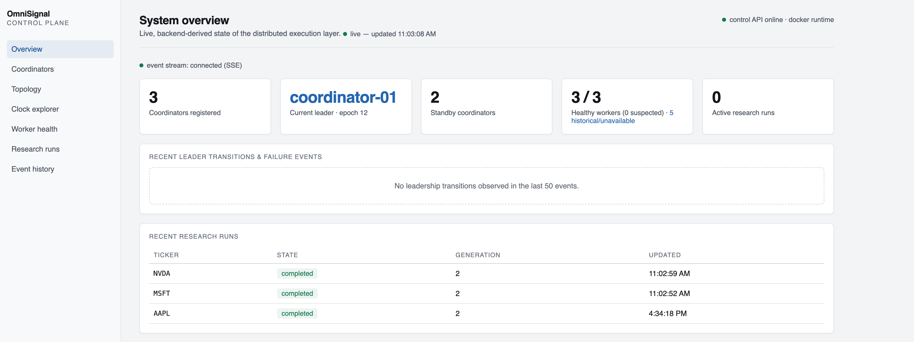
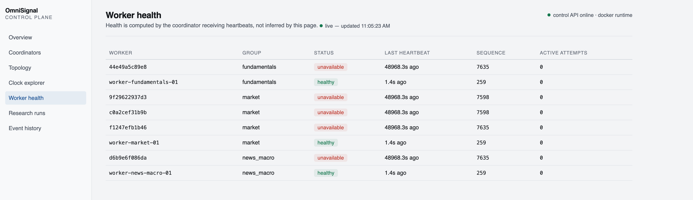
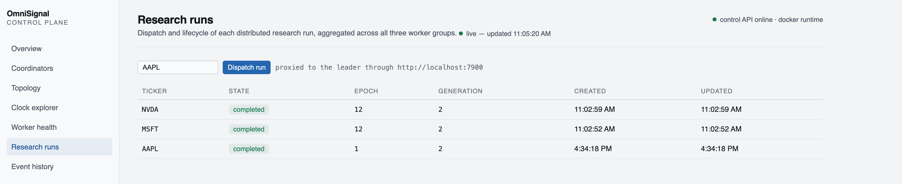
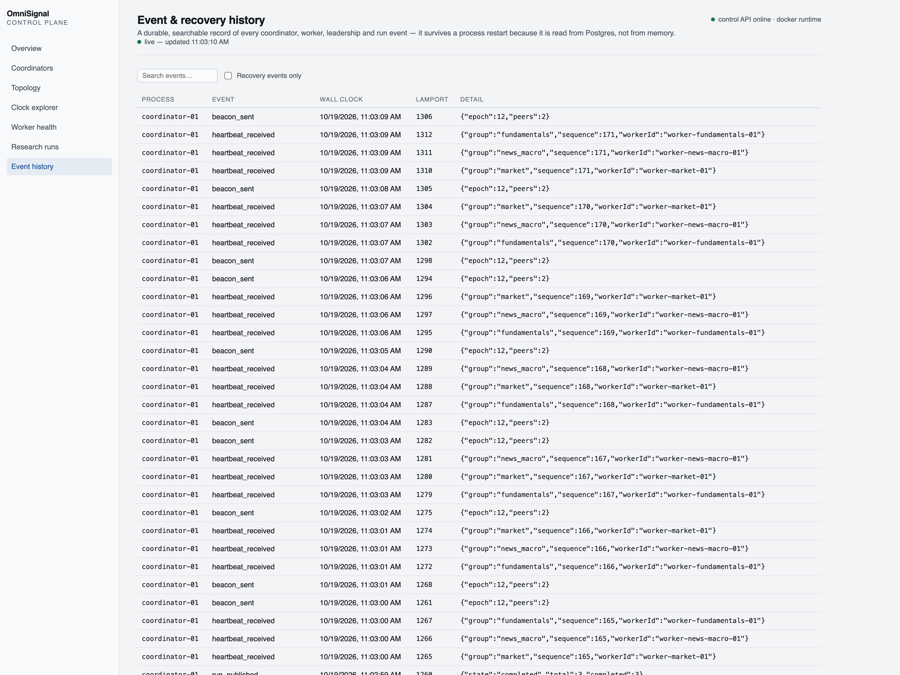
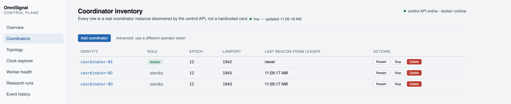
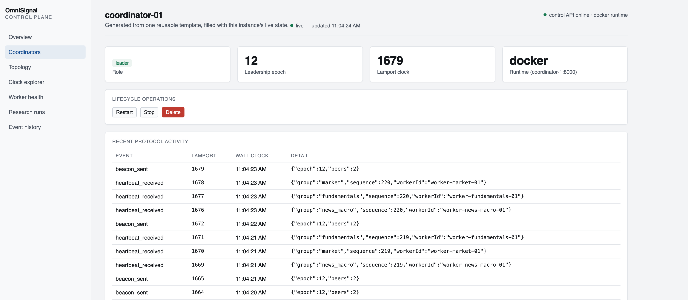
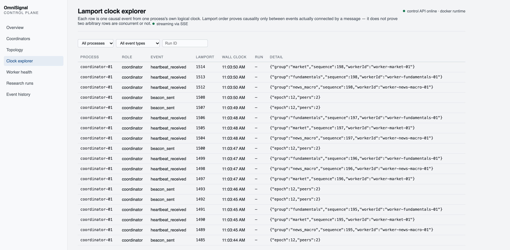

# OrchestraNet — Distributed Systems Mini Project

A fault-tolerant distributed task-orchestration system: three coordinator
nodes elect a single leader over an atomic database lease, three groups of
worker nodes execute dispatched work over gRPC, every node heartbeats its
availability over HTTP, and a live Next.js dashboard shows the whole cluster
— leader, epoch, Lamport clock, topology, and event history — while it runs.

Everything in this repository is real, running code, not a diagram. Every
screenshot in [`screenshots/`](screenshots/) was captured from this exact
project running in Docker on a local machine.

## Team

| Name | Role |
|---|---|
| **Aakash Jawle** ([@iAakash1](https://github.com/iAakash1), aakashjawle101@gmail.com) | Developer |
| **Kamaaksha Kharul** | Developer |

B.Tech. Computer Engineering, Final Year — Pimpri Chinchwad College of Engineering
Course: **Distributed Systems** (BCE27PC01) — Mini Project

## Contents

- [What this is](#what-this-is)
- [Architecture](#architecture)
- [Screenshots — live demonstration](#screenshots--live-demonstration)
- [How it works](#how-it-works)
- [Tech stack](#tech-stack)
- [Project structure](#project-structure)
- [Running it locally](#running-it-locally)
- [Scalability](#scalability)
- [Syllabus coverage](#syllabus-coverage)
- [Known limitations](#known-limitations)
- [References](#references)

## What this is

The assignment's framing is a **Command Center** coordinating multiple
**Rescue Teams** across a search-and-rescue operation: teams must be
registered, assigned work, monitored for failure, and have their unfinished
work recovered when they go silent. That framing maps directly onto what is
actually built here:

| Assignment framing | What it is in this codebase |
|---|---|
| Command Center | A **coordinator** — one of three, exactly one of which holds leadership at a time |
| Rescue Team | A **worker** — one of three groups (`market`, `fundamentals`, `news_macro`) |
| Mission | A **capability request** — `quote`, `fundamentals`, or `news` for a ticker, part of a dispatched **research run** |
| Mission assignment | gRPC unary call, `WorkerCapability.ExecuteCapability` |
| Availability monitoring | Periodic HTTP heartbeats from every worker to a coordinator |
| Mission recovery | The coordinator retries a failed capability call on the next healthy worker in the same group |

No part of the code is renamed to match the rescue-team vocabulary — the
terms above are the project's own real identifiers (`coordinator`, `worker`,
`capability`, `run`), which this table exists to translate.

## Architecture

```
                      ┌──────────────────────┐
                      │   control-plane (UI)  │  Next.js, :3100
                      └──────────┬───────────┘
                                 │ HTTP + SSE
                      ┌──────────▼───────────┐
                      │      control-api      │  FastAPI, :7900
                      └──────────┬───────────┘
                                 │ reads/writes
                      ┌──────────▼───────────┐
                      │   Postgres (shared)   │  coordinators, workers,
                      └──────────┬───────────┘  research_runs, protocol_events
                                 │
        ┌────────────────────────┼────────────────────────┐
        │                        │                        │
┌───────▼───────┐       ┌────────▼──────┐       ┌─────────▼─────────┐
│ coordinator-01 │◄─────►│ coordinator-02 │◄─────►│  coordinator-03   │
│  (HTTP beacon) │       │  (HTTP beacon) │       │   (HTTP beacon)   │
└───────┬───────┘       └───────────────┘       └────────────────────┘
        │ gRPC :9000 (ExecuteCapability)       ▲ HTTP /heartbeat
        │                                      │ (any coordinator)
┌───────▼─────────┐   ┌──────────────────┐   ┌─▼────────────────────┐
│  worker-market   │   │ worker-funda-    │   │ worker-news-macro    │
│                  │   │ mentals          │   │                      │
└──────────────────┘   └──────────────────┘   └──────────────────────┘
```

Every coordinator and worker above is a separate container, a separate OS
process, with no shared memory — they only know about each other through
HTTP, gRPC, and the shared Postgres database.

## Screenshots — live demonstration

Every image below was captured from the running system (`docker compose up`
on this repository, unmodified), not mocked up. They are grouped by the
syllabus unit each one demonstrates.

### Unit I — Architecture, independent processes

**Network topology** — the live, discovered graph: three coordinators, eight
worker nodes (current + historical), colored by role and health, drawn only
from real configuration and observed communication, never hardcoded.



**System overview** — coordinator count, current leader and epoch, worker
health, and recent research runs, read live from the backend.



### Unit II — Communication and fault tolerance

**Worker health** — status computed entirely from real HTTP heartbeats
received by a coordinator, not inferred by the dashboard. `healthy` and
`unavailable` rows sit side by side, including real historical failures from
earlier container restarts.



**Research runs** — dispatching a mission and watching it complete: each row
is a real run, routed over gRPC to a worker, with its result persisted.



**Event & recovery history** — a durable, searchable log of every
coordinator/worker/leadership/run event, read from Postgres so it survives a
process restart.



### Unit III — Synchronization

**Coordinator inventory** — every coordinator's real role (leader/standby),
leadership epoch, and Lamport clock value, live.



**Coordinator detail** — one coordinator's full state and its own recent
protocol activity (heartbeats received, beacons sent), each row carrying its
Lamport timestamp.



**Lamport clock explorer** — a live, streamed (SSE) feed of causally ordered
events across every process, each with its own logical clock value climbing
in real time.



## How it works

### Leader election — an atomic database lease, not a textbook Bully election

Three coordinators share one row in Postgres (`leadership_state`: `epoch`,
`leader_id`). Each leader periodically beacons its peers over HTTP with its
id, epoch, and peer count. A standby that stops seeing valid beacons for
longer than `beaconIntervalSeconds × beaconMissedThreshold` suspects the
leader has failed and attempts a takeover:

```sql
update leadership_state
set epoch = epoch + 1, leader_id = $1
where singleton = true and epoch = $2
returning epoch;
```

Postgres accepts exactly one such `UPDATE` per epoch — whichever
coordinator's write lands first wins the new epoch and becomes leader; every
other coordinator re-reads the row and reverts to standby. Every protected
write (a heartbeat record, a dispatched run) carries the epoch the writer
believes is current, so a coordinator that has already lost leadership can
never corrupt state under a newer epoch — this is the **fencing** that makes
the mechanism safe.

This deliberately differs from the classic Bully algorithm (no
higher-ID-wins message exchange) — it reaches the same goal, exactly one
leader at a time, through the database's own compare-and-swap instead.

### Lamport logical clocks

`distributed/common/lamportclock.py` is a thread-safe, 20-line
implementation of the textbook algorithm:

- **Local event or send:** `tick()` → `clock = clock + 1`
- **On receiving a message:** `observe(ts)` → `clock = max(clock, ts) + 1`

Every coordinator and worker owns one instance. Every recorded protocol
event (`heartbeat_received`, `beacon_sent`, `run_created`,
`capability_dispatched`, …) carries both its Lamport timestamp and a
separate UTC wall-clock timestamp, so causal order and real time are never
confused with each other.

### Dispatching and recovering a mission

1. A client `POST`s a ticker and a list of capabilities (`quote`,
   `fundamentals`, `news`) to `control-api`'s `/runs`, which proxies to
   whichever coordinator the database says is leader.
2. The leader creates a `research_runs` row and, for each capability, picks
   up to three of the most recently healthy workers in the matching group.
3. For each capability it calls the first candidate over gRPC
   (`WorkerCapability.ExecuteCapability`, a single request/response — no
   streaming). If that call fails or times out, it is retried against the
   next healthy worker in the group before the capability is given up on.
4. Every attempt — success or failure — is persisted to `worker_attempts`.
   The run's final state is `completed` (all capabilities succeeded),
   `partially_completed`, or `failed`.

### Heartbeats and failure detection

Workers do **not** keep a persistent connection open to report liveness.
Every worker sends a small HTTP `POST /heartbeat` to a coordinator roughly
once a second, carrying its id, group, a monotonic sequence number, and its
own Lamport timestamp. The receiving coordinator stamps the arrival time and
marks the worker `healthy`; a periodic sweep on every coordinator demotes a
worker to `unavailable` once its last heartbeat is older than the configured
threshold — detection never waits for a mission dispatch to fail first.

### The control plane

`control-plane/` (Next.js) is a read-only-by-default operator console: every
page polls `control-api` every 3–4 seconds, and `/clocks` additionally opens
a server-sent-events stream for live updates with a polling fallback if the
stream drops. Nothing on any page is mocked — an unreachable backend renders
an explicit empty/error state rather than fabricated numbers.

## Tech stack

| Layer | Technology |
|---|---|
| Coordinator / worker / control API | Python 3.12, FastAPI, Uvicorn |
| Inter-service RPC | gRPC + Protocol Buffers (`distributed/proto/v1/worker.proto`) |
| Shared state | PostgreSQL (one instance, four tables: `coordinators`, `workers`, `research_runs`/`worker_attempts`, `protocol_events`) |
| Operator dashboard | Next.js 16, TypeScript, React 19 |
| Deployment | Docker Compose (primary, verified) · Kubernetes manifests (written, offline-rendered — see [Known limitations](#known-limitations)) |

## Project structure

```
distributed/
├── common/            contracts, Lamport clock, config, database pool, event log
├── coordinator/        leadership (election + fencing), heartbeats, run dispatch
├── workers/
│   ├── common/          shared FastAPI app factory, gRPC servicer, test-fixture evidence
│   └── market/ fundamentals/ news_macro/    one capability handler module each
├── control_api/         read-only inventory + event stream + lifecycle actions
├── proto/v1/            worker.proto and its generated gRPC/protobuf code
├── deployment/
│   ├── compose.yaml                  the primary, verified way to run this
│   ├── dockerfiles/service.Dockerfile
│   ├── migrations/                   the Postgres schema, as two .sql files
│   └── kubernetes/                   manifests (offline-rendered only)
└── scripts/             entrypoint.py, benchmark.py, benchmark-results.csv
control-plane/            the Next.js operator dashboard (7 pages)
screenshots/               real captures used throughout this README
requirements.txt, distributed/requirements.txt    Python dependencies
```

## Running it locally

**Prerequisite:** Docker Desktop (or an equivalent Docker Engine).

```bash
git clone https://github.com/iAakash1/DSMiniProject.git
cd DSMiniProject
docker compose -f distributed/deployment/compose.yaml up --build -d
```

No API keys or `.env` file are required — workers run with
`DISTRIBUTED_TEST_ADAPTERS=true` by default, which makes every capability
answer with deterministic, clearly-labeled fixture evidence (`vendor:
"test-fixture"`) instead of calling any live data vendor. This is exactly
the mode every screenshot in this README was captured in.

| Service | URL |
|---|---|
| Control plane (dashboard) | http://localhost:3100 |
| Control API | http://localhost:7900 |
| Coordinator 1 / 2 / 3 | http://localhost:7001 / 7002 / 7003 |
| Postgres | `localhost:5532` (`omnisignal` / `omnisignal`) |

Dispatch a mission directly against the control API:

```bash
curl -X POST http://localhost:7900/runs \
  -H "Content-Type: application/json" \
  -d '{"ticker": "AAPL", "capabilities": ["quote", "fundamentals", "news"]}'
```

Stop everything (data persists in a named Docker volume across restarts):

```bash
docker compose -f distributed/deployment/compose.yaml down
```

Add `-v` to also delete the Postgres volume and start completely fresh.

## Scalability

`distributed/scripts/benchmark.py` drives concurrent requests at a chosen
worker-replica count; the recorded results
(`distributed/scripts/benchmark-results.csv`):

| Worker replicas | Concurrency | Requests | Error rate | Throughput (req/s) | p50 latency (ms) | p95 latency (ms) |
|---|---|---|---|---|---|---|
| 1 | 15 | 150 | 0.0% | 124.5 | 114.9 | 288.9 |
| 2 | 15 | 150 | 0.0% | 139.8 | 115.1 | 138.8 |
| 4 | 15 | 150 | 0.0% | 135.0 | 120.0 | 140.6 |
| 4 | 40 | 300 | 0.0% | 168.8 | 257.7 | 368.0 |

**Finding:** scaling worker replicas alone did not meaningfully move
throughput. The bottleneck is the leader's own serialized sequence of
Postgres writes inside `dispatchRun`, not worker capacity — a useful,
honest result about where the real constraint sits in this design.

## Syllabus coverage

Mapped against the course's own unit breakdown, distinguishing what is
actually **implemented and runnable** from what is only **discussed**.

### Unit I — Introduction

| Topic | Status |
|---|---|
| Distributed architecture, design issues, middleware/service boundaries | ✅ Implemented — coordinator / worker / control API / dashboard as separate services |
| Independent distributed processes | ✅ Implemented — every coordinator/worker is its own container, own OS process |
| Containerization | ✅ Implemented (Docker Compose, the verified path) · 🟡 Kubernetes manifests written, not applied to a live cluster |

### Unit II — Communication

| Topic | Status |
|---|---|
| Remote procedure calls | ✅ Implemented — gRPC unary RPC, `WorkerCapability.ExecuteCapability` |
| Request/response communication | ✅ Implemented — HTTP + typed Pydantic contracts throughout |
| Fault tolerance — worker failure | ✅ Implemented — HTTP heartbeats, threshold-based health demotion |
| Fault tolerance — leader failure | ✅ Implemented — beacon-timeout-triggered takeover (see Unit III) |

### Unit III — Synchronization

| Topic | Status |
|---|---|
| Lamport logical clocks | ✅ Implemented — `tick()`/`observe()`, exercised live on every protocol event |
| Election algorithms | 🟡 Implemented, but as an **atomic database-lease election**, not the textbook Bully/Ring message exchange |
| Epoch fencing against stale leaders | ✅ Implemented |
| Vector clocks | ❌ Not implemented |
| Distributed mutual exclusion | ❌ Not implemented |

### Unit IV — Emerging Distributed Paradigms

| Topic | Status |
|---|---|
| Distributed web-based system | ✅ Implemented — the Next.js control plane over an independent backend |
| Docker Compose | ✅ Implemented — the project's primary, verified deployment path |
| Kubernetes | 🟡 Manifests present (`distributed/deployment/kubernetes/`), validated offline, never applied to a live cluster |
| Independent worker scaling | ✅ Implemented — `docker compose up -d --scale worker-market=N` |

## Known limitations

Stated plainly rather than left for someone else to discover:

- Leader election is a real, working mechanism, but it is a database
  compare-and-swap, **not** a literal implementation of the Bully or Ring
  algorithm taught in the course.
- Vector clocks and distributed mutual exclusion are **not implemented** —
  only Lamport scalar clocks are.
- Live market-data mode (real vendor API calls instead of fixture evidence)
  depends on a provider module that is part of a larger, separate codebase
  and is **not included** in this repository. The system is built, run, and
  demonstrated entirely in fixture mode, which is deterministic and needs no
  credentials.
- Kubernetes manifests are written and validate offline
  (`kubectl kustomize`), but were never applied against a live cluster.
- Each worker group implements two capabilities, not an exhaustive set.
- Operator authentication on the control API is a single shared bearer
  token (`change-me-operator-token` in the sample compose file) — not a
  per-operator identity system. Change it before exposing this beyond a
  local machine.

## References

- Tanenbaum, A. S. & van Steen, M. — *Distributed Systems: Principles and
  Paradigms*, 2nd ed., PHI.
- Sinha, P. K. — *Distributed Operating Systems: Concepts and Design*, PHI,
  2007.
- Coulouris, G. et al. — *Distributed Systems: Concepts and Design*, 5th
  ed., Pearson.
- Kshemkalyani, A. D. & Singhal, M. — *Distributed Computing: Principles,
  Algorithms, and Systems*, Cambridge University Press.

---

Built by **Aakash Jawle** and **Kamaaksha Kharul** for the Distributed
Systems mini project, B.Tech. Computer Engineering, Pimpri Chinchwad College
of Engineering.
